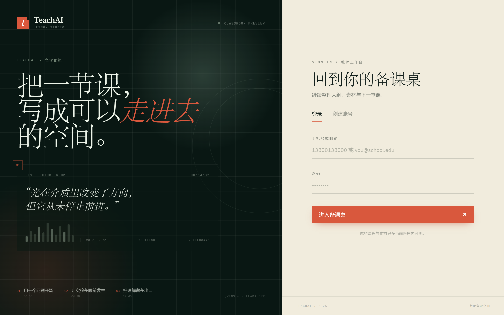
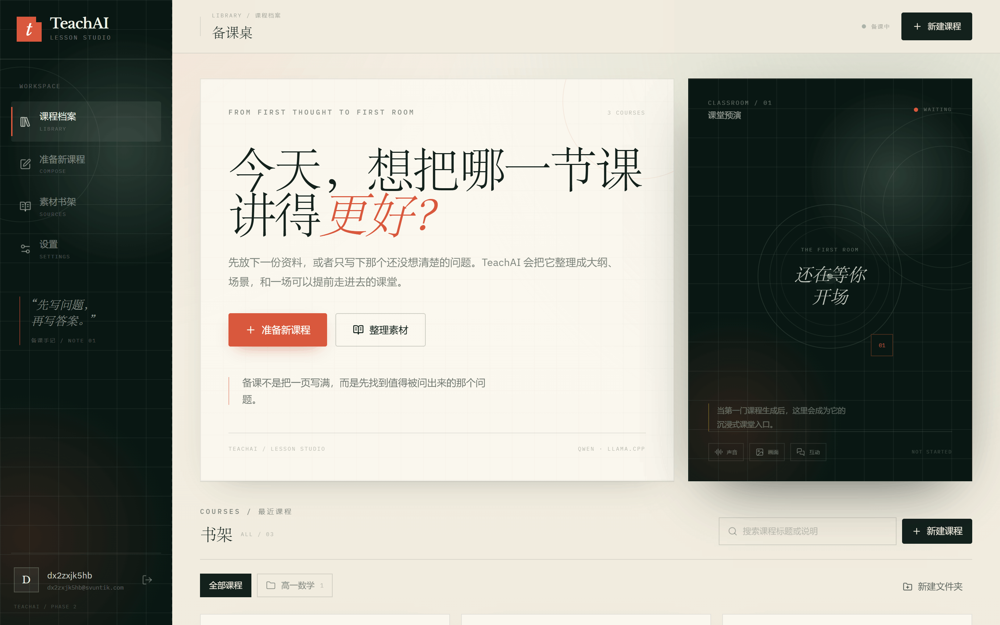
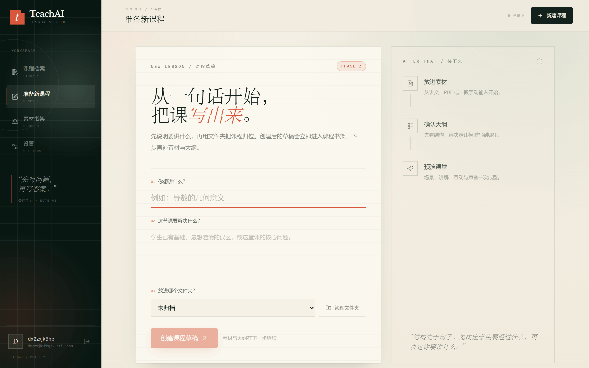
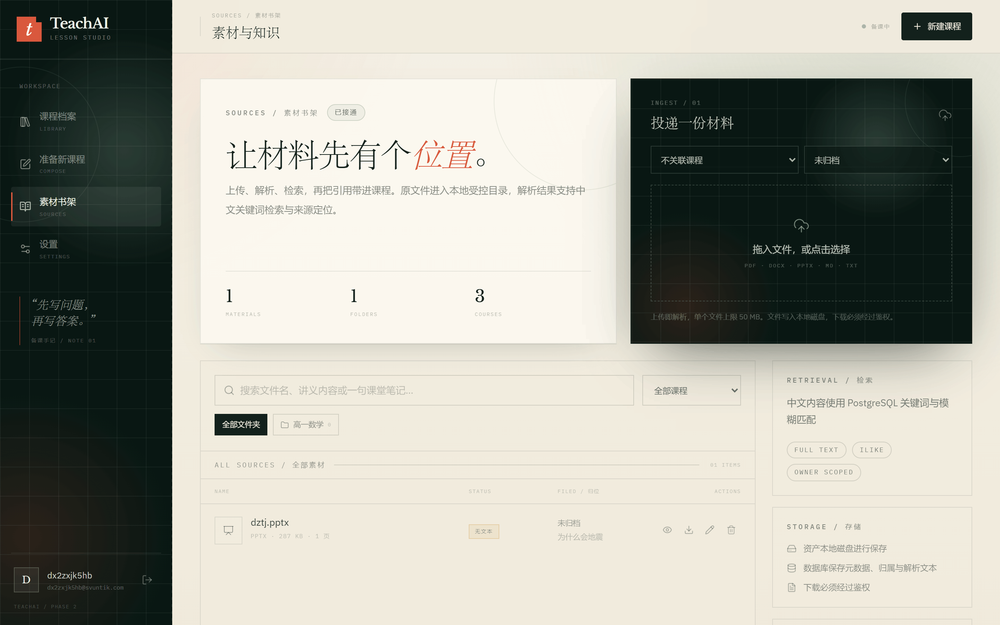
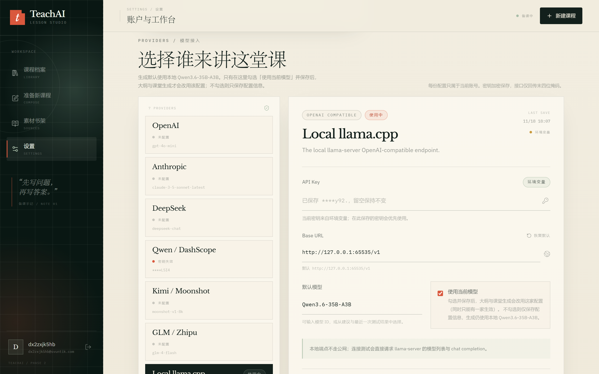
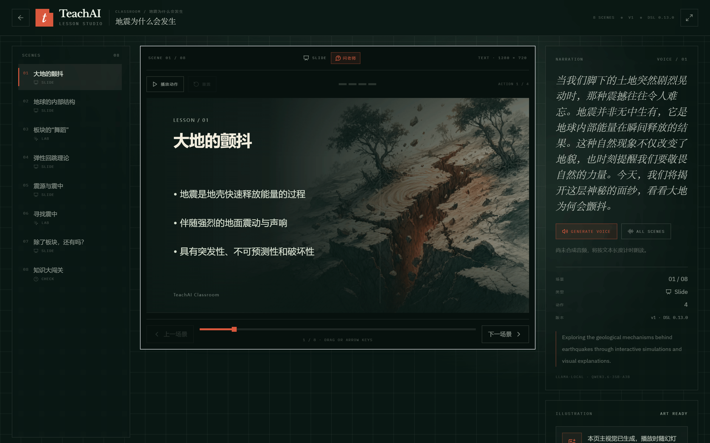
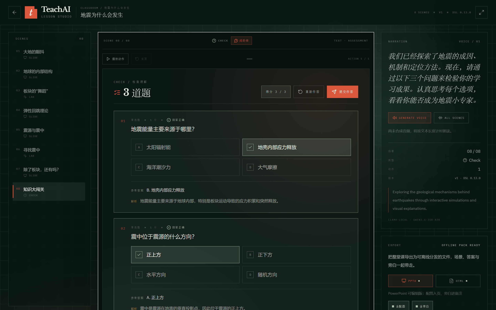
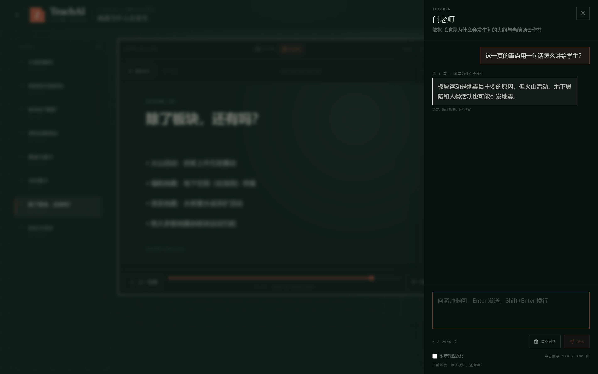

# TeachAI Agent Web

TeachAIAgent 的前端工作台：上传素材、生成大纲与课堂、沉浸式播放、向教师提问、导出课件。

**演示站点**：[ai.offer.us.ci](https://ai.offer.us.ci) · **前端仓库**：[teachai-agent-web](https://github.com/JCXYOZH/teachai-agent-web) · **后端仓库**：[teachai-agent-api](https://github.com/JCXYOZH/teachai-agent-api)

## 项目简介

TeachAIAgent 是面向教师与自学者的 AI 备课与授课工作台。用户在前端上传课件与教案，后端解析后生成课程大纲、课堂讲稿与配图，前端把课堂渲染成可播放、可答题、可导出的沉浸式页面。

本仓库是前端，基于 Next.js App Router 的单页工作台：登录与注册、课程与素材管理、模型设置、沉浸式课堂播放器、教师对话与导出。后端见 [teachai-agent-api](https://github.com/JCXYOZH/teachai-agent-api) 仓库。

## 界面预览

> 演示站点：<https://ai.offer.us.ci>。以下截图取自实际运行环境，顺序与教师备课到授课的流程一致。

### 登录与注册



左侧是课堂预演画面，右侧登录支持手机号或邮箱；注册默认手机号验证码，底部小字可切换到邮箱注册，两种账号都能登录。

### 课程档案



备课桌入口、最近课程书架与深色课堂预演并列，可新建课程、建文件夹，或直接进入已有课堂。

### 准备新课程



从一句话起稿：填写讲什么、要解决什么、归入哪个文件夹；创建后立刻进入课程档案，继续补素材与大纲。

### 素材与知识



拖拽投递 PDF、DOCX、PPTX、MD、TXT 后即时解析，列表显示解析状态、归属与体积，支持中文检索与鉴权下载。

### 模型接入



七个 Provider 分别保存 Base URL、密钥与默认模型；密钥只显示末四位，只有勾选「使用当前模型」并保存后才会切换生成模型。

### 沉浸式课堂与旁白



左侧场景栏、中间 1280×720 画布、右侧旁白面板：可播放动作流、切换场景、生成语音旁白。

### 课堂测验



课堂第 8 幕「知识大闯关」：三道选择题逐题作答，提交后即时判分并给出参考答案与解析，可重新作答。

### 问老师



教师面板依据课程大纲与当前场景作答，逐字流式返回并渲染 Markdown，输入上限 2000 字且实时计数。

## 核心功能

| 模块 | 能力 |
| --- | --- |
| 认证 | 默认手机号验证码注册，小字切换到邮箱注册；登录支持手机号或邮箱，会话由 HttpOnly refresh cookie 恢复 |
| 素材库 | 文件夹与课程管理、拖拽上传、解析预览、中文检索、编辑、鉴权下载与移除 |
| 模型设置 | 多 Provider 配置与真实连接测试、默认模型选择、「使用当前模型」开关 |
| 大纲 | 生成、手动编辑与版本展示 |
| 课堂 | 全屏沉浸播放器：场景栏、进度条、动作流播放、测验判分、项目式场景、交互组件沙箱 |
| 旁白 | 音频优先播放，无音频时回退文本计时 |
| 配图 | 单页重生成与整堂补图、Provider 选择、质量分与低分配图提示 |
| 教师对话 | 右侧教师面板，SSE 逐字流式回答，Markdown 渲染，按幕次分组显示标题 |
| 导出 | PPTX / HTML 切换与「含配图」「含旁白」开关，进度轮询与鉴权下载 |

## 设计特点

- **一个工作台，一个课堂**：编辑态是浅色纸张感的工作台，授课态是独立的深色全屏课堂，两套视觉互不干扰。
- **模型调用只在后端**：前端不持有任何 Provider Key，只在设置页写入；已保存的 Key 只显示末四位。
- **回答按需流动**：教师对话走 SSE，逐字渲染并显示「正在思考」，失败时把草稿还给输入框。
- **素材永不直链**：图片、音频与导出文件都经鉴权接口取 Blob 后转对象 URL，卸载即释放。
- **交互内容隔离**：模型生成的交互组件跑在 `sandbox` iframe 里，注入 `default-src 'none'` 的 CSP，不能联网也不能读宿主数据。
- **同源部署**：生产用相对路径 `/api/v1`，refresh 与 CSRF cookie 不跨域。

## 技术栈

| 组件 | 版本 |
| --- | --- |
| Node.js | 16.16.0 |
| Next.js | 13.5.11 |
| React | 18.2.0 |
| TypeScript | 5.4.5 |
| Tailwind CSS | 3.4.17 |
| Zustand | 4.5.5 |
| TanStack Query | 4.36.1 |
| react-hook-form | 7.51.5 |
| Zod | 3.23.8 |
| Vitest | 0.34.6 |

## 项目结构

```text
teachai-agent-web/
├── app/                          # App Router 路由
│   ├── (app)/                    # 工作台壳：library / create / knowledge / settings
│   ├── classroom/[courseId]/     # 全屏沉浸课堂
│   ├── login/                    # 登录与注册
│   └── fonts/                    # 本地化字体，构建期不访问外网
├── components/                   # auth / library / knowledge / classroom / providers / layout / ui
├── lib/
│   ├── api/                      # 类型化 API 客户端与各领域请求
│   ├── classroom/                # DSL 类型、HTML 清洗与移动端重排
│   ├── hooks/                    # 会话、工作台与生成任务 hooks
│   ├── stores/                   # Zustand 状态
│   ├── utils/                    # 格式化、下载、上传限制等工具
│   └── validators/               # Zod 校验
├── public/                       # 静态资源
├── shots/                        # 界面截图
├── tests/                        # Vitest 用例
├── docker-compose.prod.yml       # 生产编排
├── Dockerfile
└── next.config.mjs               # standalone 输出
```

## 启动

先启动 `teachai-agent-api`，再执行：

```powershell
npm install
Copy-Item .env.example .env.local
npm run dev
```

默认访问 `http://localhost:3000`，API 地址为 http://localhost:8000/api/v1

若通过 `127.0.0.1` 或局域网地址打开页面，前端会把配置为 `localhost`/`127.0.0.1` 的 API 主机名同步为当前页面主机名，避免 refresh cookie 因主机名不同而无法恢复会话。部署到独立 API 域名时保留 `NEXT_PUBLIC_API_BASE_URL` 即可。

## 页面

| 路径 | 内容 |
| --- | --- |
| `/login` | 登录；注册默认手机号，底部小字切换邮箱，两种方式都可登录 |
| `/library` | 课程与文件夹管理、搜索、深色课堂预演 |
| `/create` | 课程创建与归类 |
| `/knowledge` | 素材上传、解析预览、检索、编辑、下载与移除 |
| `/settings` | 账户、会话安全、服务状态与 Provider 配置 |
| `/classroom/[courseId]` | 全屏沉浸课堂：场景播放、旁白、配图、测验、教师对话与导出 |

登录后 access token 只保存在内存中。页面加载时通过 HttpOnly refresh cookie 恢复会话，刷新请求自动携带 CSRF 双提交令牌。受保护路由在客户端守卫中等待会话恢复，未登录会回到登录页。

素材支持 PDF、DOCX、PPTX、Markdown 与 TXT，单个文件上限 50 MB：超限文件在前端就被拦下并提示，不会发起请求；多文件上传会逐份报告失败原因。原文件写入后端资产目录下的 UUID 目录，数据库保存元数据与解析文本；下载经过鉴权 API，不公开静态目录。删除素材是软删除，物理文件由后端清理脚本按保留期处理。

## 教师对话

课堂页右侧作为教师解答面板，设定「教师」一个角色。

- 提问走 `POST /api/v1/courses/{id}/chat/messages/stream`，逐字渲染返回的 Markdown（公式、列表、代码块都按 Markdown 渲染）。
- 发送后立刻清空输入框，消息以用户气泡入列，教师侧显示「正在思考」直到首个 token 到达。
- 输入上限 2000 字（按 code point 计数），接近上限显示计数，超限时禁用发送按钮。
- 同一幕内连续问答只在幕切换时显示一次「第 N 幕 · 标题」，不再每条回答重复。
- 请求失败时把原文恢复到输入框，并给出可读错误；SSE 连接在离开页面时关闭。

## Provider 配置

设置页会读取 `/api/v1/providers`，支持 OpenAI、Anthropic、DeepSeek、Qwen、Kimi、GLM 与本地 llama.cpp。API Key 只写不读，已保存时仅显示末四位；Base URL、默认模型和默认 Provider 可以分别保存。

- 生成默认走本地 `llama-local`（`Qwen3.6-35B-A3B`）；只有勾选「使用当前模型」并保存后，才改用该 Provider 的配置。
- 不勾选只保存配置，不影响正在使用的模型。
- 连接测试会真实发送一次最小生成请求，并显示实际返回模型、延迟与发现的模型列表。

Qwen 可直接使用 DashScope 地址或自建 MaaS 兼容地址；`qwen3.8-omni-flash` 会以纯文本模态测试。配置格式与后端安全约束见 [docs/providers.md](https://github.com/JCXYOZH/teachai-agent-api/blob/master/docs/providers.md)。

## 课堂播放器

课堂页是独立于工作台壳的全屏深色路由，不用侧栏，只保留返回课程档案与全屏切换。后端返回的幻灯片 DSL 固定为 `0.13.0`、画布 1280×720：

- 桌面按容器宽度与视口高度同时等比缩放整块画布并居中，保留设计稿坐标与层级；画布不会被裁切，也不需要横向滚动。
- 移动端不缩放画布，而是从 HTML 中提取标题与要点的独立重排布局，避免正文缩到 7–8px。
- 幻灯片 HTML 渲染前经 DOM 白名单清洗，移除脚本、事件属性与 `url()`/`expression`/`javascript:` 载荷。
- 播放器支持场景栏跳转、底部进度条拖动跳转、旁白与键盘左右键；有音频旁白时按音频结束推进，无音频时回退文本计时。测验支持单选、多选与简答，提交后按题显示正误、参考答案与解析，并汇总场景得分。
- 动作事件流按 `speech → reveal / highlight` 顺序播放，支持播放、暂停、重置与逐步进度；播放前幻灯片显示完整内容，播放时逐条揭示要点。
- `interactive` 场景把模型生成的单文件组件放进 `sandbox="allow-scripts"` 的 iframe，并注入 `default-src 'none'` 的 CSP：组件可以执行内联脚本，但无法联网、读取宿主 DOM 或访问本站数据；桌面按 16:9 铺满，移动端保留 1280×720 画布横向拖动。
- `pbl` 场景渲染项目目标、最终产出与里程碑任务清单，勾选会立即保存到后端，重新进入课堂时恢复进度。
- 生成走异步任务：`POST` 立即返回 `queued` job，前端每 2 秒轮询 `GET /api/v1/generation/jobs/{id}`，用 `progress` 与 `message` 驱动进度条和步骤高亮；离开页面会中止轮询，失败时提供「重试」按钮走 `POST /api/v1/generation/jobs/{id}/retry`。
- 配图侧栏支持单页生成与整堂补图：整堂只补齐尚未配图的幻灯片（上限 6 张），已有配图时按钮转为重生成。图片不落浏览器缓存，统一通过鉴权接口取 Blob 后转成对象 URL，卸载时释放；桌面端作为深色课堂背景叠层并加渐变遮罩，移动端放在标题下方的 16:9 卡片里。低分配图会标注质量分与重生成提示。
- EXPORT 面板支持 PPTX / HTML 切换与「含配图」「含旁白」开关：创建导出任务后轮询任务进度，完成后列出文件名、体积与场景数，下载走鉴权 Blob 接口并沿用后端给出的文件名；已生成的格式在按钮上打点标记，同格式重建会覆盖旧文件。PPTX 的 slide 场景带原生「单击出现」动画；HTML 导出把交互组件嵌入 sandbox iframe，可离线操作。
- 无课堂时显示开场页；触发生成会先检查大纲，缺失时自动创建 8 场景大纲任务，再创建课堂任务。若后端返回 `409 GENERATION_IN_PROGRESS`，前端复用 `details.job_id` 继续轮询而不是重复生成。
- 未知场景类型仍显示占位卡片，提示重新生成课堂。

## 验证

```powershell
npm run typecheck
npm run lint
npm run test
npm run build
```

Vitest 当前 22 个测试文件、114 条用例，覆盖登录与注册表单校验（含手机号 / 邮箱切换）、会话恢复与跳转、Provider 保存与测试、素材格式化与 API 主机名解析、课堂加载与生成流程、幻灯片清洗与移动端文本提取、教师对话流式渲染与错误恢复、导出面板的格式与开关组合及下载回调。

## 视觉方向

- 纸张、批注红与墨绿构成教师备课手稿的视觉语言。
- 工作台保持浅色编辑感，课堂预演区使用深色沉浸背景。
- 桌面使用固定侧栏，移动端使用底部导航与安全区适配。
- 字体与动画尊重 `prefers-reduced-motion`。

## 生产部署

生产是同源容器部署，公网经海外中转机的 `frps` + frp 隧道到达 `node2`，由本机 Nginx 终止 TLS：`/` 反代到 `127.0.0.1:49153`，`/api/`、`/docs`、`/static/` 反代到 `127.0.0.1:65534`。

```bash
docker compose -f docker-compose.prod.yml up -d --build
```

- `next.config.mjs` 已开启 `output: 'standalone'`，运行镜像只包含 `server.js`、`.next/static` 和 `public`。
- `NEXT_PUBLIC_API_BASE_URL` 是构建期变量，生产值由 `docker-compose.prod.yml` 的 `build.args` 传成相对路径 `/api/v1`；修改后必须重新构建镜像，重启容器无效。
- 运行镜像以非 root 用户 `10001:10001` 监听 `49153`，`HEALTHCHECK` 探测 `/login`。
- 生产 compose 使用 `network_mode: host`，前端直接监听 `49153`，不创建 bridge 网络、不做端口映射。
- 字体已本地化到 `app/fonts`，`app/layout.tsx` 使用 `next/font/local`，构建过程不访问外网字体服务。

后端、Nginx、frp 与数据库的完整流程见 [docs/deployment.md](https://github.com/JCXYOZH/teachai-agent-api/blob/master/docs/deployment.md)。

## 许可证

本项目采用 [GNU General Public License v3.0](LICENSE)（GPL-3.0）开源：可以自由使用、修改与再分发，衍生的作品必须以相同许可证公开完整源码，并保留版权声明与许可证副本。

完整条款见仓库根目录的 [LICENSE](LICENSE)，或 <https://www.gnu.org/licenses/gpl-3.0.html>。
